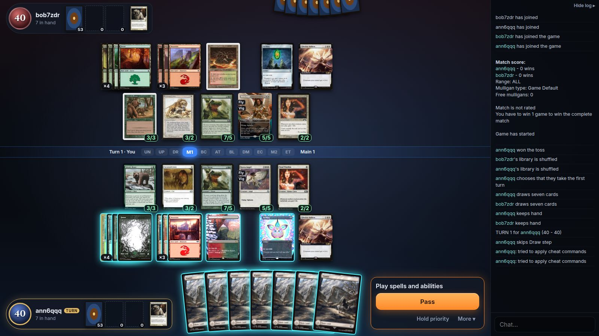

# mtg-ui

A browser client for [XMage](https://github.com/magefree/mage), built for two people playing 1v1 Commander
online. XMage's server, rules engine and card implementations are used unmodified; this repo replaces only
the Swing client.



```
Browser (React + TS)  <-- JSON / WebSocket -->  gateway (Java)  <-- XMage client protocol -->  XMage server
        web/                                      gateway/                                      ../mage
```

- **`gateway/`** – a small Java process. For every browser user it opens a normal XMage client connection
  (`mage.remote.SessionImpl`, the class the Swing client uses) and translates XMage's callbacks and view
  objects to JSON. It also starts the XMage server in the same JVM, parses pasted decklists against the
  XMage card database, and caches card and token art from Scryfall.
- **`web/`** – the React client: lobby, battlefield, hand, stack, zone piles, targeting and combat arrows,
  prompts and dialogs, animations, game log and chat.
- **`e2e/`** – Playwright tests that drive two real browsers through games.
- **`../mage`** – a plain checkout of XMage next to this repo. Nothing in it is patched.

## Play

Requirements: JDK 17+, Node 20+, and the XMage checkout at `../mage`.

```bash
scripts/build-mage.sh   # once, and again after every `git pull` in ../mage (takes several minutes)
scripts/run.sh          # builds gateway + web client, serves everything on http://localhost:8080
```

Open http://localhost:8080 in two tabs to play against yourself (each tab is its own player). Paste a
Commander decklist (Moxfield, Archidekt, MTGA or plain `1 Card Name` lines, with the commander under a
`Commander` heading), create a table in one tab, join it from the other, start.

A list without headings works too when the commander is set apart by a blank line at the end, as MTGO-style
exports do. Cards printed under another name (Universes Beyond and Secret Lair reskins, such as "Aang's
Shelter" for Teferi's Protection) are looked up on Scryfall and played as the original card; the lobby says
which ones it replaced.

### With a friend over the internet

```bash
scripts/play-online.sh
```

starts the server, opens a public tunnel and prints what to send your friend:

```
  Ready. Send your friend this:

      Link:      https://something-random.trycloudflare.com
      Password:  k3v9x2m1qa
```

Only the host runs anything; the friend opens the link, enters the password and a name, and pastes a deck.

- The tunnel is a [Cloudflare quick tunnel](https://developers.cloudflare.com/cloudflare-one/connections/connect-networks/do-more-with-tunnels/trycloudflare/)
  and needs `cloudflared` installed (no account). The link changes every time the script starts.
- `TUNNEL=tailscale scripts/play-online.sh` uses Tailscale Funnel instead; `TUNNEL=none` starts only the
  password-protected server, for a port-forward of your own.
- `GATEWAY_PASSWORD=... scripts/play-online.sh` sets the password instead of generating one.
- XMage's own port (17171) is bound to 127.0.0.1 and is never exposed.
- Players just pick a name: XMage's account system is switched off (its default); the password is what
  keeps strangers out.
- A dropped connection or a reloaded page rejoins the running game; the gateway keeps a player's session
  for 30 minutes after their browser disappears.

### In a game

- Cards you can play glow blue, legal targets glow orange, your selection glows green. While you pay
  for something, only the mana sources that can pay what is still owed are lit.
- The button at the bottom right is always the default action (Pass, Resolve, Attack, Keep, …); `Space`
  or `F2` presses it. `Y` / `N` answer questions, `Esc` cancels.
- Library, graveyard and exile are piles next to each player. Click a graveyard or exile pile to look
  through it; a pile with a blue `▶n` holds cards you can play from there (flashback, adventures). A
  revealed top card of the library lies face up on its pile and can be played from there. The graveyard's
  tooltip says how many card types it holds.
- Revealed cards, cards you look at, the hand of a player you control, exile piles made by a card and
  the companion zone open as lists on the left; they fold away and stay until you close them.
- Hover any card for a large view: both halves of split and adventure cards, the other side of
  double-faced cards, what your own face-down card really is, printed power/toughness when it was
  changed, counters, keyword icons and XMage's notes (commander casts and damage, day/night, restrictions).
  `More ▾ → Hints…` collects all those notes in one panel.
- The stack is on the right, oldest on top, the next thing to resolve at the bottom in full.
- `More ▾` holds the pass modes, rollback requests, settings, hints, your sideboard, asking to see the
  opponent's hand, macro recording and conceding (the game or the whole match).

| Key | |
|---|---|
| `Space`, `F2` | confirm / pass |
| `F3` | stop passing |
| `F4` | pass until next turn |
| `F5` | pass until end step |
| `F6` | pass until next turn, also for things on the stack |
| `F7` | pass until next main phase |
| `F9` | pass until my next turn |
| `F10` | pass until the stack resolves |
| `F11` | pass until the end step before my turn |
| `F8` | start / stop recording a macro |
| `F12` | go to the chat |
| `Ctrl` (held) | hold priority: keep it after casting, to respond to your own spell |
| `Ctrl+Z` | undo mana tapped while holding priority |

### Tables

Every table is a standard two-player Commander game: 40 life, seven cards, the normal mulligan, the
Commander banlist, no clock, a single game. There is nothing to set up.

## Settings

`Settings` in the lobby, `More ▾ → Settings and stops…` or a click on the phase bar in a game. Like MTG
Arena, there is little to configure. The settings are kept in the browser and apply at once, also to a
running game.

- **Stops** – a box for each step (upkeep, draw, first main, beginning of combat, end of combat, second
  main, end step) for your turn and for the opponent's: where the game waits for you when the stack is
  empty. Unticked steps pass by themselves. Default: both main phases on your turn, the end step on the
  opponent's. Whenever a spell or ability is cast you get the chance to respond anyway.
- **Order my triggers by itself when the order does not matter** – on by default.
- **Card size** on the battlefield, **animation speed** (normal, fast, off) and whether the **log** is shown.
- *Forget remembered answers* drops every "always yes / no", remembered trigger order and replacement
  choice of the current game; *Back to defaults* resets the rest.

How the game behaves otherwise is fixed:

- After you cast a spell or activate an ability, priority passes by itself. Hold `Ctrl` (or click "Hold
  priority") to keep it and respond to your own spell.
- Mana in your pool is spent automatically, except mana that was there before you started casting.
- A land with several mana abilities asks which one; you are asked before passing with mana in your pool.
- A target is chosen for you only when there is exactly one legal target.

XMage has more switches (pass-mode fine-tuning, table variants such as other starting life totals, a chess
clock, Planechase, best of three). The client supports them, but shows them only when the server runs in
test mode (`XMAGE_TEST_MODE=true`), where the tests use them; a normal server ignores them.

## Tests

```bash
cd e2e
npm install
npx playwright install ffmpeg   # once, for the recordings
npm test                        # everything
node ../scripts/parity.mjs --check
```

The tests use Google Chrome (`E2E_BROWSER_CHANNEL=chromium` plus `npx playwright install chromium` for the
bundled browser instead). They start their own servers on other ports and stop them afterwards;
`E2E_KEEP_SERVERS=1` leaves them running between runs (`scripts/stop-test-servers.sh` stops them), and
`E2E_SKIP_BUILD=1` skips rebuilding the gateway and web client.

| Project | Command | What it does |
|---|---|---|
| `scenarios` | `npm run test:scenarios` | short games on a server in XMage's test mode, each set up with test commands to prove one thing: every prompt, card form, setting, menu entry and key |
| `games` | `npm run test:games` | six whole games with legal 100-card decks on a server with normal rules, played by two bots through the UI until someone loses: three with mono-coloured decks, three with two-colour decks (planeswalkers, modal spells, tokens, graveyard recursion, counterspells); plus deck validation in the lobby |
| `online` | `npm run test:online` | runs `scripts/play-online.sh` and plays through the public tunnel link |
| `captures` | `npm run capture` | layout checks at three resolutions and the animation frames and recordings in `docs/captures` |

**[docs/parity.md](docs/parity.md)** lists everything XMage's network contract and the Swing client's
game panel offer – every field of the view classes, every server callback, prompt option, player action
and setting, every menu entry, hotkey and dialog, and every control of this client's settings panel and
table options – with the test that proves the web client handles it.
It is generated from the XMage sources by `scripts/parity.mjs`; with `--check` it fails when an item has
no entry or names a test that does not exist, so an XMage update that adds something shows up there.

Three kinds of tests do not go through a real game situation, and say so in the parity list:
messages XMage sends only on internal errors or admin broadcasts, and one prompt type current XMage no
longer sends (`GAME_PLAY_XMANA`), are fed to the client directly; the pass-mode keys other than `F4` and
`F9` are checked by the action they send.

The online test checks, through the public link: the script prints link and password, a wrong password is
rejected (in the UI and on the raw websocket), a game starts, player A's connection is cut and stays down
for a few seconds and then recovers with the board intact, player B reloads mid-game, and the game is then
played to its end.

### Captures

`docs/captures/layout/` – the board at 1280×720, 1600×900 and 1920×1080 with 5, 15 and 30 permanents per
side, the stack with 1, 5 and 12 items and the hand with 1, 7 and 15 cards. The tests that take them also
measure the page: nothing scrolls, the table's sections don't overlap, no permanent leaves the table or
covers a player panel, neighbouring slots don't cover each other, the stack never covers a panel or the
prompt, every stack item and hand card is entirely on screen, and every card in a crowded stack or hand
keeps a visible strip of its own.

`docs/captures/animations/` – frames and two recordings (`player-a.webm`, `player-b.webm`, one per side of
the same game) of: drawing, casting, the opponent casting, damage on a creature, a spell resolving, a
creature dying, exile with life gain, a bounce to hand, an attack, and life loss.

`docs/captures/events/` – frames of: a die roll, a coin flip, a library search and shuffle, tokens coming
out of the spell that makes them, counters going on and coming off, a hand being revealed, a discard, a
mill, a countered spell, combat damage hitting a player, and the phase and the turn changing.

Each of these tests asserts that the animation in question is actually running while it happens; the
frames are taken at the moments the effect is on screen.

## How it works

XMage sends whole board snapshots, never "this card moved". The client animates in two ways:

- A card that is on screen before and after a snapshot keeps one element (Motion's shared layout id), so
  hand → stack → battlefield → graveyard pile are continuous moves.
- For cards coming from or going to hidden zones, `web/src/game/motion.ts` compares consecutive snapshots:
  new cards fly in from the library pile or the opponent's hand, and cards that vanish leave a copy that
  flies to the graveyard, exile, hand or library.

Every prompt is XMage's own (`ClientCallbackMethod`), answered with one of five typed replies. Clicking a
card, permanent or player sends its id; the prompt bar's buttons send yes/no; dialogs send the rest.

### Protocol

Browser → gateway: `{id, cmd, ...}`; every command gets `{type:"reply", id, ok, data|error}`.

| cmd | |
|---|---|
| `hello {token?, password?}` | first message; re-attaches to a running session after a reload or reconnect |
| `login {username}` | connect to XMage |
| `checkDeck {deck}` | validate a pasted decklist |
| `tables`, `createTable {deck,…}`, `joinTable {tableId, deck}`, `leaveTable`, `startMatch` | lobby |
| `respond {gameId, kind, value}` | answer a prompt; `kind` = `uuid` \| `boolean` \| `string` \| `integer` \| `manaType` |
| `action {gameId, action, data?}` | `mage.constants.PlayerAction` (pass modes, undo, rollback, concede, …) |
| `settings {settings}` | the player's XMage preferences (`UserData`): stop steps, mana payment, targeting, … |
| `submitDeck {tableId, main, sideboard}` | the rearranged deck between the games of a match |
| `quitMatch` | concede the whole match |
| `chat {chatId, message}` | |
| `cheat` | test mode only: run a command group from `config/init.txt` |
| `keepalive` | answered with `{type:"pong"}`; the client reconnects when the answers stop |

Gateway → browser: `{type:"event", method, objectId, messageId, data}` where `method` is XMage's
`ClientCallbackMethod` (`GAME_INIT`, `GAME_SELECT`, `GAME_TARGET`, `CHATMESSAGE`, …). The JSON shapes are
defined in `gateway/.../ViewMapper.java` and mirrored in `web/src/protocol/types.ts`.

## Settings (environment variables)

| Variable | Default | |
|---|---|---|
| `GATEWAY_PORT` | `8080` | HTTP / WebSocket port |
| `GATEWAY_PASSWORD` | empty | shared password for everyone who connects (`play-online.sh` always sets one) |
| `GATEWAY_HEAP` | `3g` | JVM heap (the XMage server lives in this process) |
| `SESSION_TIMEOUT_MINUTES` | `30` | how long a player's session survives without a browser |
| `RUN_DIR` | `run/` | runtime files: XMage config, card database, image cache, logs |
| `XMAGE_PORT` | `17171` | port of the embedded XMage server (written into a new `RUN_DIR/config/config.xml`) |
| `XMAGE_EMBEDDED` | `true` | `false` = connect to an already running XMage server at `XMAGE_HOST` |
| `XMAGE_TEST_MODE` | `false` | XMage test mode: no deck validation, test commands (see below) |
| `XMAGE_MAX_GAMES` | `10` | games XMage runs at the same time (written into a new config) |
| `XMAGE_GAME_TYPE` / `XMAGE_DECK_TYPE` | Commander Two Player Duel / Variant Magic - Commander | defaults for new tables |
| `MAGE_DIR` | `../mage` | XMage checkout used by the scripts |

`RUN_DIR/config/config.xml` is copied from XMage on first start and can be edited.

**Test mode** (`XMAGE_TEST_MODE=true scripts/run.sh`) is handy for trying things out: write command groups
to `run/config/init.txt` in XMage's format (`battlefield:<player>:Forest:5`, `hand:<player>:Lightning Bolt:1`,
`token:<player>:TreasureToken:3`; see `../mage/Mage.Server/release/config/init.example.txt`) and run one
from `More ▾ → Test mode: run commands` while you have priority.

## Updating XMage

```bash
git -C ../mage pull && scripts/build-mage.sh && scripts/run.sh
```

New and fixed cards need nothing else. The gateway only has to change when XMage changes its network
contract (`Mage.Common`: `mage.view.*`, `MageServer`, `ClientCallbackMethod`); that shows up as a compile
error in `gateway/`, mostly in `ViewMapper.java`. If the XMage version number changes, update `mage.version`
in `gateway/pom.xml`. `build-mage.sh` also refreshes `gateway/src/main/resources/token-images.tsv`, the
token-to-art table extracted from XMage's sources. `MAGE_COMMIT` records the XMage commit this was last
built and tested against; run the tests after an update.

## Layout

```
gateway/    Java gateway (Maven); the JSON contract lives in ViewMapper.java
web/        React + TypeScript client (Vite)
e2e/        Playwright tests, test decks, the bot that plays whole games
scripts/    build-mage.sh, run.sh, play-online.sh, parity.mjs, smoke.mjs, stop-test-servers.sh
docs/       parity.md (generated) and the captures taken by the tests
mvnw        Maven wrapper, so no system Maven is needed
run*/       runtime files, created on first start, not committed
```

## Known gaps

Left out on purpose; these are the "out of scope" rows of [docs/parity.md](docs/parity.md):

- sound
- drafts
- sealed
- tournaments
- more than two players
- replays
- spectating
- deck editor (decks are pasted as lists)

## License and credits

The code in this repository is released under the [MIT License](LICENSE).

- **[XMage](https://github.com/magefree/mage)** (MIT) provides the server, the rules engine and every card
  implementation. None of its code is copied here; the gateway is built against a separate checkout.
- Card and token images are fetched from **[Scryfall](https://scryfall.com)** at runtime and cached locally.
  They are not part of this repository, apart from the screenshots and recordings in `docs/captures`.

mtg-ui is unofficial Fan Content permitted under the
[Fan Content Policy](https://company.wizards.com/en/legal/fancontentpolicy). Not approved/endorsed by Wizards.
Portions of the materials used are property of Wizards of the Coast. ©Wizards of the Coast LLC.
